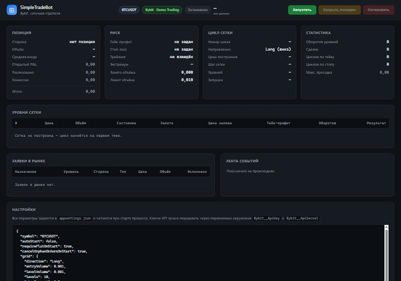
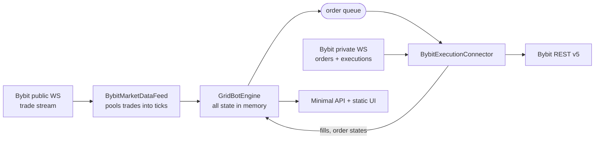

# SimpleTradeBot

**A small, readable grid trading bot for Bybit perpetuals — one instrument, no database, everything in memory, with a built-in web UI.**

[](https://github.com/Snake0369/SimpleTradeBot/actions/workflows/ci.yml)
[](https://dotnet.microsoft.com/)
[](LICENSE)

English · [Русский](README.ru.md)



---

## What this is

A compact, production-shaped implementation of a classic **grid strategy** on Bybit USDT
perpetuals. It is extracted from a much larger private trading system and deliberately stripped
down to the parts worth reading: the grid maths, the exchange connector, and a small engine that
keeps them honest.

No database, no message bus, no scheduler. One process, one instrument, all state in memory —
start it, and what you see in the UI is the whole truth.

**Highlights**

- **Real Bybit V5 connector.** Orders over REST, order states and executions over the private
  WebSocket, linked by our own `orderLinkId`. The public trade stream feeds the strategy.
- **Demo trading first.** Ships pointed at Bybit Demo Trading: a real market, virtual money.
  `Testnet` and `Live` are one config value away.
- **Position reconciliation before every close.** The bot asks the exchange what it actually
  holds before sending a closing order. If the exchange says flat, the close is cancelled — in
  the original system a close against a stale ledger once *opened* a reverse position.
- **Everything configurable in `appsettings.json`**, nothing hidden in code.
- **Zero-build UI.** Plain HTML, CSS and JavaScript — no npm, no bundler. `dotnet run` and open
  the page.
- **51 unit tests** covering the grid maths, the position book and the full trading cycle against
  a fake exchange.

---

## How the strategy works

This is the strategy known in the original system as *grid one*: a ladder of limit orders below
(or above) an anchor price, each with its own take-profit, plus a position-wide take-profit,
stop-loss and trailing stop.

```
            price
              ▲
   1 010.0 ───┼──  take-profit for level 1        sell limit, reduce-only
              │
   1 000.0 ───┼──  anchor — market entry          EntryVolume
              │
     990.0 ───┼──  level 1                        buy limit, LevelVolume
     980.0 ───┼──  level 2                        buy limit, LevelVolume × VolumeFactor
     970.0 ───┼──  level 3                        …
              │
     940.5 ───┼──  stop-loss for the whole position
```

**The cycle**

1. On the first tick the bot takes the price as the **anchor**, builds `Levels` levels from it
   and, if `EntryVolume > 0`, enters at market.
2. It keeps the nearest `MaxOpenOrders` levels working as limit orders — never on the wrong side
   of the market, never beyond `MaxPositionVolume`.
3. When a level fills it gets a **take-profit one grid step away**. When that take-profit is
   bought back, the level is re-armed and can fill again. This is what a grid earns on in a
   sideways market.
4. The **position-wide take-profit** closes everything at once, including the market-entry volume
   that belongs to no level. The **stop-loss** and the **trailing stop** do the same in the other
   direction.
5. After the position is closed the cycle either restarts from the current price
   (`RestartAfterTakeProfit`) or the bot stops.

Step and volume both support progressions: `PriceFactor` spreads the levels apart as price runs
away, `VolumeFactor` scales each level's size. `VolumeFactor > 1` is a martingale — size grows
exponentially, and `MaxPositionVolume` is what stands between you and a liquidation.



Decisions are taken under a single lock; orders leave through a queue, so a slow exchange
response never blocks tick processing.

---

## Quick start

**Requirements:** [.NET 9 SDK](https://dotnet.microsoft.com/download) (or Docker).

### 1. Get API keys

Create a key in [Bybit Demo Trading](https://www.bybit.com/) with the **Trade** permission.
Demo trading uses the real market and virtual money — the right place to watch the bot work.

### 2. Configure

Everything lives in
[`src/SimpleTradeBot.Web/appsettings.json`](src/SimpleTradeBot.Web/appsettings.json).
Keys are better kept out of the file:

```bash
cd src/SimpleTradeBot.Web
dotnet user-secrets set "Bybit:ApiKey" "<your key>"
dotnet user-secrets set "Bybit:ApiSecret" "<your secret>"
```

or as the environment variables `Bybit__ApiKey` and `Bybit__ApiSecret`.

### 3. Run

```bash
dotnet run --project src/SimpleTradeBot.Web
```

Open <http://localhost:5080> and press **Запустить** (Start).

### Docker

```bash
cp .env.example .env     # put your keys there
docker compose up --build
```

The UI is on <http://localhost:5080>.

---

## Configuration

### `Bybit`

| Setting | Default | Meaning |
|---|---|---|
| `Environment` | `DemoTrading` | `DemoTrading`, `Testnet` or `Live`. |
| `ApiKey`, `ApiSecret` | empty | Use environment variables or user-secrets instead of the file. |
| `Leverage` | `1` | Applied to the instrument on start. `1` means no leverage. |
| `TickPoolMs` | `300` | Window for merging exchange trades into one tick. |

> Market data always comes from the **live** exchange even in `DemoTrading` mode: Bybit's demo
> host serves accounts and orders only, and demo prices *are* the real prices. `Testnet` is the
> exception — it has its own market, so both data and orders go there.

### `Bot`

| Setting | Default | Meaning |
|---|---|---|
| `Symbol` | `BTCUSDT` | The single instrument this process trades. |
| `AutoStart` | `false` | Start trading as soon as the process starts. |
| `RequireFlatOnStart` | `true` | Refuse to start if the exchange already holds a position on the symbol. |
| `CancelOrphanOrdersOnStart` | `true` | Cancel leftover orders from a previous run — state is in memory, so the bot cannot adopt them. |
| `EventLogSize` | `300` | How many events the in-memory feed keeps. |

### `Bot:Grid`

| Setting | Default | Meaning |
|---|---|---|
| `Direction` | `Long` | `Long` builds the ladder downwards, `Short` upwards. |
| `EntryVolume` | `0.001` | Market entry at the start of a cycle, in base coin. `0` — no entry, limit orders only. |
| `LevelVolume` | `0.001` | Size of one grid level. |
| `Levels` | `10` | How many levels to build. |
| `StepPercent` | `0.3` | Grid step as a percentage of the anchor price. |
| `StepTicks` / `FixedStepInTicks` | `0` / `false` | Grid step in ticks instead of percent. |
| `VolumeFactor` | `1.0` | Volume progression: level *N* = `LevelVolume × VolumeFactor^(N−1)`. |
| `PriceFactor` | `1.0` | Step progression: step *N* = `step × PriceFactor^(N−1)`. |
| `TakeProfitPercent` | `1.5` | Position-wide take-profit, percent from entry. `null` disables it. |
| `TakeProfitBase` | `Dynamic` | `Dynamic` — from the weighted average entry; `Fixed` — from the deepest filled level. |
| `AlignTakeProfitToGrid` | `false` | Per-level take-profit measured from the level price instead of the actual fill price. |
| `StopLossPercent` | `5.0` | Position-wide stop-loss, percent. `null` disables it. |
| `StopLossBase` | `Dynamic` | Same two modes as the take-profit. |
| `TrailingStopPercent` | `0` | Arms once the position is this far in profit, fires on the same retracement from the extreme. |
| `MaxOpenOrders` | `5` | How many level orders to keep working. `0` — the whole plan. |
| `MaxPositionVolume` | `0.01` | Cap on position size, counted as open volume plus live level orders. `0` — no cap. |
| `RestartAfterTakeProfit` | `true` | Rebuild the grid from the new price after a position-wide take-profit. |
| `RestartAfterStopLoss` | `false` | Same after a stop-loss. Off by default: a stop means the market went against the grid. |

The per-level take-profit distance is **one grid step** — not `TakeProfitPercent`, which is the
position-wide exit. That is how the original strategy works, and it is what makes a grid pay in
a range.

---

## HTTP API

| Method | Path | What it does |
|---|---|---|
| `GET` | `/api/state` | Full snapshot: status, position, risk levels, grid, live orders, events. |
| `POST` | `/api/start` | Start the bot. |
| `POST` | `/api/stop` | Cancel orders, close the position at market, stop. |
| `POST` | `/api/close` | Close the position and rebuild the grid from the current price, keep running. |
| `GET` | `/api/settings` | Effective configuration (API keys reported as a boolean only). |
| `GET` | `/health` | Liveness plus bot status. |

---

## Project layout

```
src/
├── SimpleTradeBot.Core/      strategy and domain — no exchange dependencies
│   ├── Configuration/        everything appsettings.json binds to
│   ├── Domain/               InstrumentSpec, GridLevel, PositionBook, Tick
│   ├── Execution/            IExecutionConnector — the exchange-neutral contract
│   ├── Strategy/             GridBuilder (pure maths) + GridBotEngine (the cycle)
│   └── State/                snapshot for the UI, in-memory event log
├── SimpleTradeBot.Bybit/     Bybit.Net V5: instruments, trade feed, order execution
├── SimpleTradeBot.Web/       Minimal API + static UI
└── SimpleTradeBot.Tests/     xUnit: grid maths, position book, full cycle on a fake exchange
```

`Core` knows nothing about Bybit. Swapping exchanges means one new project implementing
`IExecutionConnector`, `IMarketDataFeed` and `IInstrumentProvider`.

```bash
dotnet test src/SimpleTradeBot.sln
```

---

## What it deliberately does not do

These are choices, not gaps:

- **No persistence.** State lives in the process. A restart starts a new cycle — which is why
  leftover orders are cancelled on start and the bot refuses to start on top of an existing
  position.
- **No position adoption.** The bot does not take over a position it did not open. If one is
  there, it says so and stops.
- **It does not close your position on shutdown.** `docker compose restart` cancels orders and
  leaves the position alone; closing it is a decision for a human, or for the **Stop** button.
- **One instrument per process.** Three symbols means three containers with different
  `Bot__Symbol` values.
- **A partially filled level has no take-profit until its order settles.** Re-pricing a
  take-profit on every partial fill is a race worth avoiding; the position-wide stop covers that
  window.

---

## Disclaimer

This software is published for educational and demonstration purposes. Trading perpetual futures
carries substantial risk, and grid strategies with volume progression can lose far more in a
trending market than they make in a range. Nothing here is financial advice. You run it at your
own risk — start on Demo Trading, read the code, and never trade money you are not prepared to
lose.

## License

[MIT](LICENSE) © Nikolay Gromazin
