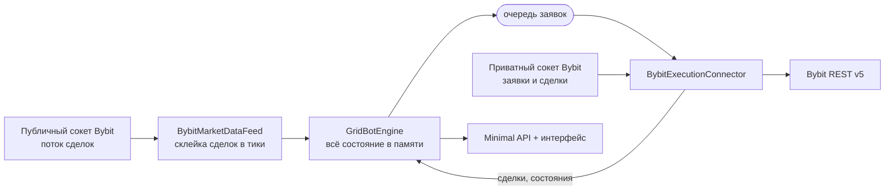

# SimpleTradeBot

**Небольшой сеточный бот для перпетуалов Bybit: один инструмент, без базы, всё состояние в памяти, со встроенным веб-интерфейсом.**

[](https://github.com/Snake0369/SimpleTradeBot/actions/workflows/ci.yml)
[](https://dotnet.microsoft.com/)
[](LICENSE)

[English](README.md) · Русский


---

## Что это

Компактная реализация классической **сеточной стратегии** на USDT-перпетуалах Bybit. Она вынута
из большой закрытой торговой системы и намеренно сведена к тому, что стоит читать: математика
сетки, коннектор к бирже и небольшой движок, который держит их в рамках.

Ни базы, ни шины сообщений, ни планировщика. Один процесс, один инструмент, всё состояние в
памяти — запустил, и то, что видно в интерфейсе, это и есть вся правда о боте.

**Что внутри**

- **Настоящий коннектор Bybit V5.** Заявки по REST, состояния заявок и сделки — приватным
  сокетом, связка держится на собственном `orderLinkId`. Стратегию кормит публичный поток сделок.
- **По умолчанию — демо-торговля.** Реальный рынок, виртуальные деньги. `Testnet` и `Live`
  переключаются одним значением в настройках.
- **Сверка позиции перед каждым закрытием.** Прежде чем отправить закрывающую заявку, бот
  спрашивает биржу, что у неё на самом деле. Если позиции там нет — закрытие отменяется: в
  исходной системе закрытие по устаревшему учёту однажды *открыло* встречную позицию.
- **Все настройки в `appsettings.json`**, ничего не спрятано в коде.
- **Интерфейс без сборки.** Чистые HTML, CSS и JavaScript — ни npm, ни бандлера. `dotnet run` и
  открыть страницу.
- **51 модульный тест** на математику сетки, учёт позиции и весь торговый цикл на подставной
  бирже.

---

## Как работает стратегия

Это та самая «сетка1» из исходной системы: лесенка лимитных заявок ниже (или выше) цены
построения, у каждой свой тейк-профит, плюс общие по позиции тейк-профит, стоп-лосс и трейлинг.

```
            цена
              ▲
   1 010.0 ───┼──  тейк-профит уровня 1           лимит на продажу, reduce-only
              │
   1 000.0 ───┼──  anchor — рыночный вход         EntryVolume
              │
     990.0 ───┼──  уровень 1                      лимит на покупку, LevelVolume
     980.0 ───┼──  уровень 2                      LevelVolume × VolumeFactor
     970.0 ───┼──  уровень 3                      …
              │
     940.5 ───┼──  стоп-лосс по всей позиции
```

**Цикл**

1. На первом тике бот берёт цену за **anchor**, строит от неё `Levels` уровней и, если
   `EntryVolume > 0`, входит рыночной заявкой.
2. Дальше он держит в рынке ближайшие `MaxOpenOrders` уровней — никогда по ту сторону цены и
   никогда сверх `MaxPositionVolume`.
3. Залитый уровень получает **тейк-профит на один шаг сетки**. Когда тейк выкуплен, уровень
   возвращается в строй и может залиться снова — именно на этом сетка и зарабатывает в боковике.
4. **Общий тейк-профит** закрывает позицию целиком, включая объём рыночного входа, у которого
   своего уровня нет. **Стоп-лосс** и **трейлинг** делают то же самое в другую сторону.
5. После закрытия цикл либо начинается заново от текущей цены (`RestartAfterTakeProfit`), либо
   бот останавливается.

И шаг, и объём поддерживают прогрессию: `PriceFactor` разводит уровни при уходе цены,
`VolumeFactor` наращивает объём каждого следующего. `VolumeFactor > 1` — это мартингейл, объём
растёт экспоненциально, и единственное, что стоит между вами и ликвидацией, —
`MaxPositionVolume`.



Решения принимаются под одним замком, а заявки уходят через очередь: медленный ответ биржи не
останавливает обработку тиков.

---

## Быстрый старт

**Нужно:** [.NET 9 SDK](https://dotnet.microsoft.com/download) или Docker.

### 1. Получить ключи

Выпустите ключ в разделе демо-торговли Bybit с правом **Trade**. Демо-торговля идёт по реальному
рынку виртуальными деньгами — это и есть правильное место, чтобы посмотреть на бота.

### 2. Настроить

Всё лежит в
[`src/SimpleTradeBot.Web/appsettings.json`](src/SimpleTradeBot.Web/appsettings.json).
Ключи в файле держать не стоит:

```bash
cd src/SimpleTradeBot.Web
dotnet user-secrets set "Bybit:ApiKey" "<ключ>"
dotnet user-secrets set "Bybit:ApiSecret" "<секрет>"
```

или переменными окружения `Bybit__ApiKey` и `Bybit__ApiSecret`.

### 3. Запустить

```bash
dotnet run --project src/SimpleTradeBot.Web
```

Открыть <http://localhost:5080> и нажать **Запустить**.

### Docker

```bash
cp .env.example .env     # вписать туда ключи
docker compose up --build
```

Интерфейс — на <http://localhost:5080>.

---

## Настройки

### `Bybit`

| Параметр | По умолчанию | Что делает |
|---|---|---|
| `Environment` | `DemoTrading` | `DemoTrading`, `Testnet` или `Live`. |
| `ApiKey`, `ApiSecret` | пусто | Лучше задавать окружением или через user-secrets. |
| `Leverage` | `1` | Выставляется на инструмент при запуске. `1` — торгуем на своё. |
| `TickPoolMs` | `300` | Окно склейки сделок биржи в один тик. |

> Рыночные данные даже в режиме `DemoTrading` берутся с **боевой** биржи: демо-хост Bybit
> обслуживает только счёт и заявки, а котировки демо-счёта — это котировки настоящего рынка.
> Исключение — `Testnet`: у него свой рынок, туда идут и данные, и заявки.

### `Bot`

| Параметр | По умолчанию | Что делает |
|---|---|---|
| `Symbol` | `BTCUSDT` | Единственный инструмент процесса. |
| `AutoStart` | `false` | Запускать бота сразу при старте процесса. |
| `RequireFlatOnStart` | `true` | Не запускаться, если на инструменте уже есть позиция. |
| `CancelOrphanOrdersOnStart` | `true` | Снимать заявки прошлого запуска: состояние в памяти, подхватить их бот не может. |
| `EventLogSize` | `300` | Сколько событий держать в ленте. |

### `Bot:Grid`

| Параметр | По умолчанию | Что делает |
|---|---|---|
| `Direction` | `Long` | `Long` строит лесенку вниз, `Short` — вверх. |
| `EntryVolume` | `0.001` | Рыночный вход в начале цикла, в базовой монете. `0` — только лимитные доборы. |
| `LevelVolume` | `0.001` | Объём одного уровня. |
| `Levels` | `10` | Сколько уровней строить. |
| `StepPercent` | `0.3` | Шаг сетки в процентах от цены построения. |
| `StepTicks` / `FixedStepInTicks` | `0` / `false` | Шаг сетки в тиках вместо процента. |
| `VolumeFactor` | `1.0` | Прогрессия объёма: уровень *N* = `LevelVolume × VolumeFactor^(N−1)`. |
| `PriceFactor` | `1.0` | Прогрессия шага: шаг *N* = `шаг × PriceFactor^(N−1)`. |
| `TakeProfitPercent` | `1.5` | Общий тейк-профит в процентах от цены входа. `null` — выключен. |
| `TakeProfitBase` | `Dynamic` | `Dynamic` — от средневзвешенной цены входа, `Fixed` — от дальнего залитого уровня. |
| `AlignTakeProfitToGrid` | `false` | Поуровневый тейк считать от цены уровня, а не от фактической цены исполнения. |
| `StopLossPercent` | `5.0` | Общий стоп-лосс в процентах. `null` — выключен. |
| `StopLossBase` | `Dynamic` | Те же два режима, что у тейк-профита. |
| `TrailingStopPercent` | `0` | Взводится при выходе в плюс на столько же процентов, срабатывает на таком же откате от экстремума. |
| `MaxOpenOrders` | `5` | Сколько заявок добора держать в рынке. `0` — весь план. |
| `MaxPositionVolume` | `0.01` | Лимит объёма позиции: открытый объём плюс живые заявки добора. `0` — без лимита. |
| `RestartAfterTakeProfit` | `true` | Перестраивать сетку от новой цены после общего тейка. |
| `RestartAfterStopLoss` | `false` | То же после стопа. По умолчанию выключено: стоп означает, что рынок пошёл против сетки. |

Расстояние поуровневого тейк-профита равно **одному шагу сетки**, а не `TakeProfitPercent` —
последний относится к выходу по всей позиции. Так устроена исходная стратегия, и именно это
заставляет сетку зарабатывать в диапазоне.

---

## HTTP API

| Метод | Путь | Что делает |
|---|---|---|
| `GET` | `/api/state` | Полный снимок: статус, позиция, уровни риска, сетка, живые заявки, события. |
| `POST` | `/api/start` | Запустить бота. |
| `POST` | `/api/stop` | Снять заявки, закрыть позицию по рынку, остановиться. |
| `POST` | `/api/close` | Закрыть позицию и перестроить сетку от текущей цены, не останавливая бота. |
| `GET` | `/api/settings` | Действующие настройки (про ключи — только признак «заданы»). |
| `GET` | `/health` | Живость процесса и статус бота. |

---

## Структура

```
src/
├── SimpleTradeBot.Core/      стратегия и домен — без зависимостей от биржи
│   ├── Configuration/        всё, во что биндится appsettings.json
│   ├── Domain/               InstrumentSpec, GridLevel, PositionBook, Tick
│   ├── Execution/            IExecutionConnector — нейтральный к бирже контракт
│   ├── Strategy/             GridBuilder (чистая математика) + GridBotEngine (цикл)
│   └── State/                снимок для интерфейса, лента событий в памяти
├── SimpleTradeBot.Bybit/     Bybit.Net V5: инструменты, фид сделок, исполнение заявок
├── SimpleTradeBot.Web/       Minimal API + интерфейс
└── SimpleTradeBot.Tests/     xUnit: математика сетки, учёт позиции, цикл на подставной бирже
```

`Core` ничего не знает про Bybit. Сменить биржу — это один новый проект с реализациями
`IExecutionConnector`, `IMarketDataFeed` и `IInstrumentProvider`.

```bash
dotnet test src/SimpleTradeBot.sln
```

---

## Чего бот намеренно не делает

Это решения, а не пробелы:

- **Не хранит состояние.** Оно живёт в процессе. Перезапуск начинает новый цикл — поэтому
  заявки прошлого запуска снимаются на старте, а поверх чужой позиции бот не встаёт.
- **Не подхватывает чужую позицию.** Если она есть — скажет об этом и не запустится.
- **Не закрывает позицию при остановке процесса.** `docker compose restart` снимает заявки и
  оставляет позицию как есть: закрывать её — решение человека или кнопки **Остановить**.
- **Один инструмент на процесс.** Три символа — три контейнера с разным `Bot__Symbol`.
- **Частично залитый уровень остаётся без тейка, пока его заявка не дошла до конечного
  состояния.** Переставлять тейк на каждую сделку — гонка, которой лучше избежать; это окно
  закрывает общий стоп-лосс.

---

## Предупреждение

Проект опубликован в учебных и демонстрационных целях. Торговля перпетуальными фьючерсами
сопряжена с существенным риском, а сеточные стратегии с прогрессией объёма в тренде теряют
намного больше, чем зарабатывают в боковике. Ничто здесь не является инвестиционной
рекомендацией. Вы запускаете это на свой страх и риск — начните с демо-торговли, прочитайте код
и не торгуйте деньгами, которые не готовы потерять.

## Лицензия

[MIT](LICENSE) © Николай Громазин
